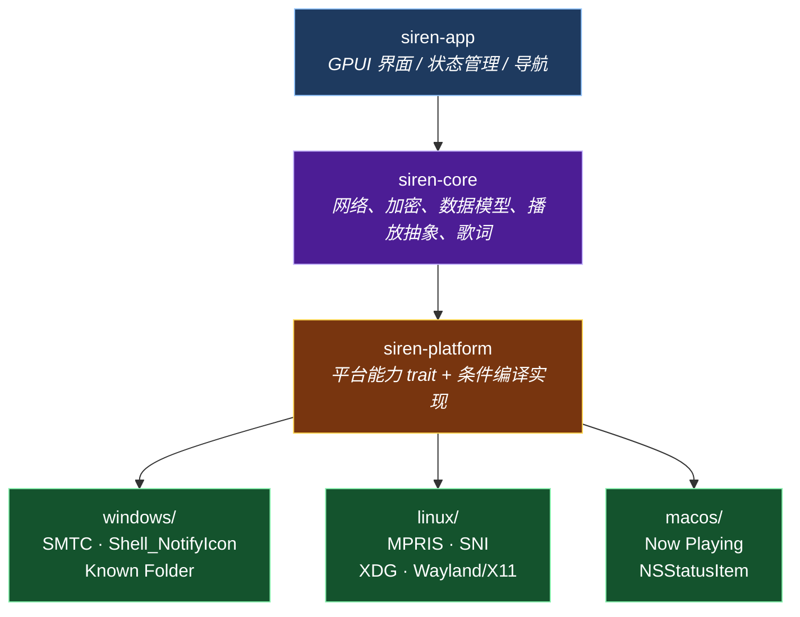

# Siren

<div align="center">

基于 **Rust + GPUI** 构建的跨平台网易云音乐桌面客户端

[](LICENSE)
[]()
[](https://www.rust-lang.org)

</div>

---

## 项目简介

Siren 是一个原生（native-first）的跨平台桌面音乐客户端，设计目标为**单一 Rust 代码库同时交付 Windows、Linux 与 macOS**。

与 JVM/Compose 路线相比，本项目选择 Rust + 平台原生库的组合，以换取更小的体积、更低的启动与内存开销，以及对 Linux 桌面生态（XDG / MPRIS / StatusNotifierItem）更直接的支持。

> 本项目的**架构设计与平台能力规格**继承自 rinchao0721 的 Android/Compose 桌面端探索项目
> [Melodia](https://github.com/rinchao0721/Melodia)，并将其沉淀的经验用于 Rust 实现。

---

## 当前状态

项目已越过脚手架阶段，**Windows 上可日常使用**：登录、浏览、搜索、歌单管理、播放与歌词均已打通，
可产出 NSIS 安装包。各平台的状态如下：

| 平台 | 状态 | 说明 |
|---|---|---|
| **Windows** | ✅ 主要开发与验证平台 | SMTC / 托盘 / 单实例 / 窗口几何全部可用；`cargo packager` 产出 NSIS 安装包 |
| **Linux** | 🟡 已接线，待实机验证 | 走 Wayland 优先路线；MPRIS 与托盘走 D-Bus（与显示协议无关）；**X11 句柄层待补**，Wayland 下窗口显隐/几何按协议降级 |
| **macOS** | ⬜ 规划中（阶段 4） | 保留完整目录结构与接口，当前实现为占位降级 |

功能完成度详见 [`docs/08-功能对照与清单.md`](docs/08-功能对照与清单.md)，
阶段计划详见 [`docs/06-路线图.md`](docs/06-路线图.md)，
已知问题与整改项详见 [`docs/整改清单.md`](docs/整改清单.md)。

---

## 技术栈

| 领域 | 选型 | 说明 |
|---|---|---|
| 语言 | **Rust** | 单一代码库，三平台交付（`rust-version = 1.85`） |
| UI 框架 | **gpui-kit** | 基于 [GPUI](https://github.com/zed-industries/zed)（Zed 出品）的组件框架，Longbridge Pro 商业验证 |
| 渲染 | GPU 加速 | Direct3D 11 / Metal / Vulkan，由 GPUI 后端选择 |
| 音频引擎 | **libmpv** | 运行时动态加载（`libloading`），缺失时降级为静音引擎而非崩溃 |
| 系统媒体控制 | **playwire** | SMTC（Windows）/ MPRIS（Linux）/ Now Playing（macOS）统一 API |
| 系统托盘 | **tray-icon** | Linux 走 `ksni`（纯 D-Bus），避开 GTK3 依赖 |
| 目录规范 | **directories** | 跨平台标准目录（XDG / Known Folder / Apple 规范） |
| 网络 | **reqwest + rustls** | 纯 Rust TLS，无 OpenSSL 依赖 |
| 异步 | **tokio** | 运行时由 `run()` 持有，仅把 `Handle` 交给 UI |

> 选型依据与备选方案详见 [`docs/03-技术选型.md`](docs/03-技术选型.md)。

---

## 架构概览

项目采用**平台能力抽象 + 条件编译**的架构：核心逻辑跨平台复用，平台差异通过 trait 抽象并由 `#[cfg(target_os)]` 在编译期选择实现。



**核心约束**：`#[cfg(target_os)]` **只允许出现在 `siren-platform`**。

| crate | 职责 | 允许平台分支 |
|---|---|---|
| `siren-app` | GPUI 页面与组件、状态管理、导航外壳 | ❌ |
| `siren-core` | 网易云 API（WEAPI/EAPI）、加密、数据模型、libmpv 绑定、歌词解析 | ❌ |
| `siren-platform` | 平台能力接口与三平台实现，全 crate 唯一的平台选择点 | ✅ |

平台能力以 trait 定义（`WindowSystem` / `MediaSession` / `NativeLibraryLocator`）或统一函数契约
（`open_url` / `ensure_single_instance` / `device_prefixes`）暴露；**漏实现某个平台会在编译期失败**，
这是设计意图而非疏漏。详见 [`docs/01-架构设计.md`](docs/01-架构设计.md) 与
[`docs/02-平台能力规格.md`](docs/02-平台能力规格.md)。

状态管理遵循「单一真源 / 窄化 owner / generation 判代」，详见
[`docs/10-状态管理约定.md`](docs/10-状态管理约定.md)。

---

## 功能范围

### 已实现

- **登录**：二维码扫码登录、Cookie 登录、会话持久化与自动续期
- **首页**：推荐歌单、每日推荐等区块
- **搜索**：单曲 / 专辑 / 歌手 / 歌单多类型
- **音乐库**：我的歌单（含新建 / 改名 / 简介 / 删除 / 封面上传裁剪）、收藏的专辑与歌手、关注与粉丝
- **详情页**：歌单、专辑、歌手、个人主页、最近播放（歌曲 / 歌单 / 专辑）
- **播放**：播放队列、顺序 / 列表循环 / 单曲循环 / 随机模式、8 档音质切换、音量、歌曲红心
- **歌词**：LRC / YRC / QRC 解析（含逐字时间轴）与译文
- **评论**：列表、点赞、楼层查看
- **正在播放面板**：歌词 / 评论 / 歌曲详情 / 音乐记忆 / 歌手简介 / 歌手专辑 / 相似歌手卡片，顺序与显隐可配置
- **系统集成**：系统媒体控制（SMTC / MPRIS）、系统托盘、单实例、窗口位置记忆、关闭到托盘
- **会话恢复**：冷启动恢复队列、当前曲与播放进度
- **主题**：深色主题 + 封面取主色
- **打包**：Windows NSIS 安装包（cargo-packager）

### 尚未实现

- **播客**、**下载管理**、**云盘**、**换源 / LX 插件**
- **边播边缓存**（libmpv `stream-record`）与四级磁盘缓存
- **桌面歌词窗口**（含点击穿透；Wayland 无此协议，将明确降级）
- **全局快捷键**、**开机自启**
- **浅色主题**、逐字歌词染色、全屏播放器、睡眠定时
- **Linux X11 窗口句柄层**；macOS 平台层

---

## 构建与运行

### 依赖

- **Rust**：stable 通道（`rust-toolchain.toml` 已声明；最低 1.85）
- **Windows**：MSVC 工具链 + Windows SDK（`build.rs` 经 `winresource` 调 `rc.exe` 编译图标与版本资源；缺工具链时只警告、不中断构建）
- **Linux**：GPUI 所需的系统库，以及 libmpv：

  ```bash
  # Debian / Ubuntu
  sudo apt install pkg-config libxkbcommon-dev libxkbcommon-x11-dev \
       libwayland-dev libx11-xcb-dev libxcb1-dev libxcb-render0-dev \
       libxcb-shape0-dev libxcb-xfixes0-dev libfontconfig1-dev \
       libfreetype-dev libasound2-dev libmpv-dev

  # Arch
  sudo pacman -S base-devel libxkbcommon wayland libxcb fontconfig freetype2 alsa-lib mpv
  ```

- **macOS**：Xcode Command Line Tools

### 运行

```bash
cargo run -p siren-app              # 调试构建（依赖仍按 opt-level=2 优化，UI 不卡）
cargo run --release -p siren-app    # 发布构建（LTO + strip）
```

`libmpv` 为**运行时动态加载**，无需导入库、也不参与链接：

| 平台 | 查找顺序 |
|---|---|
| Windows | 可执行文件同目录的 `libmpv-2.dll`（仓库不包含，需自备）；缺失时应用照常启动，仅不出声 |
| Linux | `libmpv.so.2` → `libmpv.so` → 系统 `mpv` |
| macOS | `libmpv.2.dylib`（Homebrew 路径） |

### UI 冒烟（截图）

无显示环境（CI / 远程）下也能起界面并截图：脚本用 Xvfb + 软件 GL 启动应用，
可指定歌单直接打开、滚到列表底部，产物在 `target/ui-smoke/`。

```bash
scripts/ui-smoke.sh                                             # 只截首页
SMOKE_PLAYLIST=569850893 SMOKE_SCROLL=40 scripts/ui-smoke.sh    # 打开歌单并滚到底
```

依赖：`Xvfb`、ImageMagick（`import` / `convert`）、`python3`（经 `libXtst` 发滚轮）。
`SMOKE_PLAYLIST` 走开发入口 `SIREN_START=playlist:<id>`，其余可调项见脚本头注释。

### 打包（Windows）

```bash
cargo install cargo-packager --locked
# 打包前把 libmpv-2.dll 放到 assets/native/windows/bin/（不入库，说明见 assets/native/windows/README.md）
cargo packager -p siren-app --release
```

`resources` 用 `*.dll` 通配而不是写死文件名，所以**全新 clone 也能直接打包**；
但缺 DLL 时产物没有音频引擎（应用降级为静音模式，首次播放会提示一次）。
发布前请显式确认素材齐备：

```powershell
Get-ChildItem assets/native/windows/bin/*.dll
```

产物为 NSIS 安装包，输出在 `target/release/`。字体与图标已 `include_bytes!` 进二进制，无需额外打包。

### 打包（Arch Linux）

`resources/package/archlinux/` 下有 `siren-git` 的 PKGBUILD、桌面文件与说明：

```bash
cd resources/package/archlinux
makepkg -si
```

### 环境变量

| 变量 | 作用 |
|---|---|
| `SIREN_X` / `SIREN_Y` / `SIREN_W` / `SIREN_H` | 覆盖起始窗口位置与大小（开发期多开调试用） |
| `SIREN_LOG_DIR` | 覆盖日志目录 |
| `SIREN_LOG_LEVEL` | `off`/`error`/`warn`/`info`/`debug`/`trace`，默认 `info` |
| `SIREN_LOG_STDERR` | 设为 `0`/`false`/`no` 时不镜像到标准错误（默认镜像） |
| `SIREN_START` | 开发入口：`search` / `settings` / `account` / `recent` / `artist` / `playlist:<id>`，启动即跳到对应页面 |
| `RC` / `RC_x86_64_pc_windows_msvc` / `WINDRES` | 指定资源编译器（MSVC / GNU 交叉构建各取所需，见 `winresource`） |

### 数据与日志位置

由 `directories` 的 `ProjectDirs::from("com", "cyanrhythm", "Siren")` 决定，例如 Windows：

```text
%APPDATA%\cyanrhythm\Siren\config\      session.json / settings.json
                                        playback_queue.json / playback_state.json
%APPDATA%\cyanrhythm\Siren\data\logs\   log.log（1 MiB 轮转，保留 3 份历史）
```

Linux 对应 `~/.config/siren/`，macOS 对应 `~/Library/Application Support/com.cyanrhythm.Siren/`。

---

## 目录结构

```text
Siren/
├── crates/
│   ├── siren-app/            # 应用层：GPUI 界面与状态
│   │   ├── build.rs          # Windows 资源编译（图标 / 版本信息）
│   │   └── src/ui/           # pages/ · components/ · covers · playback · smooth_scroll
│   ├── siren-core/           # 跨平台核心
│   │   └── src/              # crypto/ · network/ · model/ · player/ · lyrics/ · auth/
│   └── siren-platform/       # 平台能力层（唯一允许平台分支）
│       └── src/              # windows/ · linux/(wayland · x11 · mpris · sni) · macos/
├── assets/                   # 字体、图标、打包素材、原生库（libmpv 不入库）
├── docs/                     # 设计与审查文档
└── .opencode/skills/         # gpui-kit 官方 Agent Skills（随上游更新，勿就地改）
```

---

## 文档索引

| 文档 | 内容 |
|---|---|
| [`docs/01-架构设计.md`](docs/01-架构设计.md) | 模块划分、分层原则、数据流 |
| [`docs/02-平台能力规格.md`](docs/02-平台能力规格.md) | 平台能力接口定义与踩坑记录 |
| [`docs/03-技术选型.md`](docs/03-技术选型.md) | 各依赖的选型依据、备选方案与风险 |
| [`docs/04-迁移规格.md`](docs/04-迁移规格.md) | 从 Melodia 继承的功能需求与经验教训 |
| [`docs/05-PoC验证清单.md`](docs/05-PoC验证清单.md) | 立项前需验证的技术风险点 |
| [`docs/06-路线图.md`](docs/06-路线图.md) | **战略**：分阶段计划、优先级、风险 |
| [`docs/07-开发计划.md`](docs/07-开发计划.md) | **战术**：执行顺序、工作分解、工作量评估 |
| [`docs/08-功能对照与清单.md`](docs/08-功能对照与清单.md) | **功能粒度**：与 Melodia 的差距对照清单 |
| [`docs/09-动效制作指南.md`](docs/09-动效制作指南.md) | GPUI 动画 / 弹簧 / 关键帧的用法与落地清单 |
| [`docs/10-状态管理约定.md`](docs/10-状态管理约定.md) | 状态归属、单一真源、事件订阅、异步取消 |
| [`docs/整改清单.md`](docs/整改清单.md) | 代码与设计规范审查的整改项（含状态勾选） |
| [`docs/评审意见.md`](docs/评审意见.md) | 对整改清单的逐条复核结论 |
| [`docs/点击交互审查报告.md`](docs/点击交互审查报告.md) | 与 Melodia 的点击/跳转交互对照 |
| [`docs/缓存优化.md`](docs/缓存优化.md) | 图片缓存的现状分析与优化方案 |

---

## 贡献

提交前必须跑通以下三条（CI 同样执行；详见 [`CONTRIBUTING.md`](CONTRIBUTING.md)）：

```bash
cargo fmt --all -- --check
cargo clippy --workspace --all-targets -- -D warnings
cargo test --workspace
```

提交信息采用约定式提交：`type(scope): 中文描述`，scope 取 `app` / `core` / `platform`（或更细的
`net` / `player` / `lyrics` / `linux` / `windows` / `macos` / `deps`），正文按「问题 → 改动」书写。

**改动涉及 UI 时请先读 `.opencode/skills/gpui-kit/references/coding-guides.md`** —— 上游将其列为强制规范。

---

## 免责声明

1. 本项目为个人技术交流与 Rust 桌面开发生态学习研究所用。
2. 本项目不包含任何商业目的，不提供任何形式的商业变现或增值服务。
3. 软件中调用的所有音频及元数据均来源于公开网络接口，版权归属于原权利人所有。
   请在下载安装后 24 小时内删除，严禁用于任何商业用途。

---

## 许可

本项目基于 [MIT License](LICENSE) 开源。
