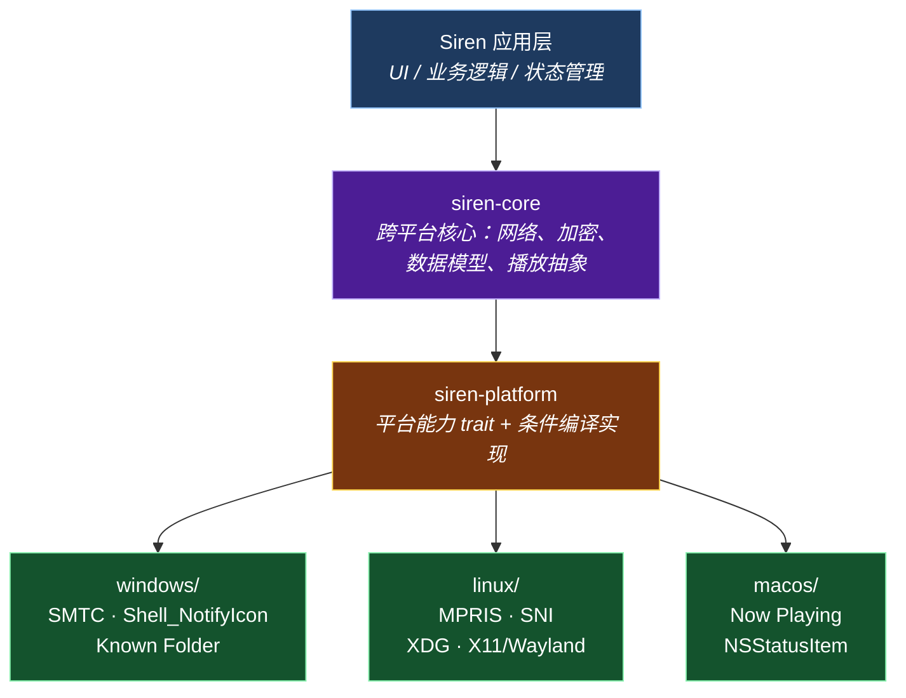

# Siren

基于 **Rust + GPUI** 构建的跨平台网易云音乐桌面客户端

---

## 项目简介

Siren 是一个原生（native-first）的跨平台桌面音乐客户端，设计目标为**单一 Rust 代码库同时交付 Windows、Linux 与 macOS**。

与 JVM/Compose 路线相比，本项目选择 Rust + 平台原生库的组合，以换取更小的体积、更低的启动与内存开销，以及对 Linux 桌面生态（XDG / MPRIS / StatusNotifierItem）更直接的支持。

> 本项目的**架构设计与平台能力规格**继承自 rinchao0721 的 Android/Compose 桌面端探索项目
> [Melodia](https://github.com/rinchao0721/Melodia)，并将其沉淀的经验用于 Rust 实现。

---

## 技术栈

| 领域 | 选型 | 说明 |
|---|---|---|
| 语言 | **Rust** | 单一代码库，三平台交付 |
| UI 框架 | **gpui-kit** | 基于 [GPUI](https://github.com/zed-industries/zed)（Zed 出品）的组件框架，16.9k★，Longbridge Pro 商业验证 |
| 渲染 | GPU 加速 | 目标 120 FPS 下的流畅滚动与动画 |
| 音频引擎 | **libmpv** | 跨平台音视频内核，支持流式播放与 `stream-record` 边播边缓存 |
| 系统媒体控制 | **playwire**（首选） 或 `zbus` 自研 MPRIS | SMTC（Windows）/ MPRIS（Linux）统一 API |
| 系统托盘 | **tray-icon** | Tauri 团队出品，3425 万下载，封装三平台差异 |
| 目录规范 | **directories** | 跨平台标准目录（XDG / Known Folder / Apple 规范） |
| 全局快捷键 | **global-hotkey** | Tauri 团队出品 |
| 开机自启 | **auto-launch** | 跨平台自启封装 |

> 选型依据与备选方案详见 [`docs/03-技术选型.md`](docs/03-技术选型.md)。

---

## 架构概览

项目采用**平台能力抽象 + 条件编译**的架构：核心逻辑跨平台复用，平台差异通过 trait 抽象并由 `#[cfg(target_os)]` 在编译期选择实现。

**设计原则**：平台差异**只允许**存在于 `platform/` 层。上层通过 trait 调用，由编译期决定具体实现——利用 Rust 的类型系统，使"遗漏某平台实现"在编译期即被拒绝。

详见 [`docs/01-架构设计.md`](docs/01-架构设计.md)。

---

## 文档索引

| 文档 | 内容 |
|---|---|
| [`docs/01-架构设计.md`](docs/01-架构设计.md) | 模块划分、分层原则、数据流、状态管理 |
| [`docs/02-平台能力规格.md`](docs/02-平台能力规格.md) | 平台能力 trait 定义（继承自 Melodia 的接口设计） |
| [`docs/03-技术选型.md`](docs/03-技术选型.md) | 各依赖的选型依据、备选方案与风险评估 |
| [`docs/04-迁移规格.md`](docs/04-迁移规格.md) | 从 Melodia 继承的功能需求与踩坑记录 |
| [`docs/05-PoC验证清单.md`](docs/05-PoC验证清单.md) | 立项前需验证的技术风险点 |
| [`docs/06-路线图.md`](docs/06-路线图.md) | 分阶段实施计划 |

---

## 目标平台

| 平台 | 状态 | 说明 |
|---|---|---|
| **Linux** | 🎯 优先 | 原生支持 X11 / Wayland；这是相对 JVM 方案优势最大的平台 |
| **Windows** | 🎯 优先 | 覆盖大部分用户；SMTC 与托盘能力成熟 |
| **macOS** | ⏳ 规划中 | GPUI 原生支持；Now Playing 需接入 MediaPlayer 框架 |

---

## 功能范围（规划）

- **音乐播放**：在线流播、播放队列、循环/随机模式
- **音质切换**：标准 / 高 / 无损
- **歌词**：滚动歌词、逐字歌词、桌面歌词窗口（点击穿透）
- **系统集成**：系统媒体控制（SMTC / MPRIS）、托盘、全局快捷键、开机自启
- **音乐库**：歌单、专辑、歌手、最近播放
- **搜索**：歌曲 / 歌单 / 歌手 / 专辑多模式
- **播客**：电台与节目
- **缓存**：流式播放边缓存（离线可听）
- **主题**：封面取色、深色/浅色

---

## 开发路线

详见 [`docs/06-路线图.md`](docs/06-路线图.md)。

---

## 构建

> 项目处于规划阶段，构建指令将在脚手架就绪后补充。

预计依赖：

- Rust 1.80+（推荐通过 [rustup](https://rustup.rs) 安装）
- Linux 额外需要：`libmpv-dev`、`libx11-dev`、`libwayland-dev`、`libxkbcommon-dev`
- Windows：MSVC 工具链
- macOS：Xcode Command Line Tools

---

## 免责声明

1. 本项目为个人技术交流与 Rust 桌面开发生态学习研究所用。
2. 本项目不包含任何商业目的，不提供任何形式的商业变现或增值服务。
3. 软件中调用的所有音频及元数据均来源于公开网络接口，版权归属于原权利人所有。
   请在下载安装后 24 小时内删除，严禁用于任何商业用途。

---

## 许可

本项目基于 [MIT License](LICENSE) 开源。
