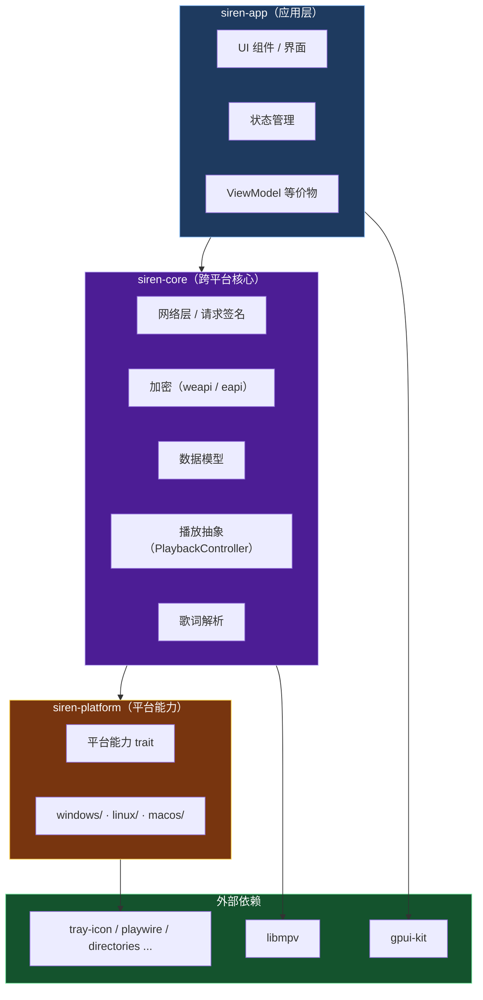
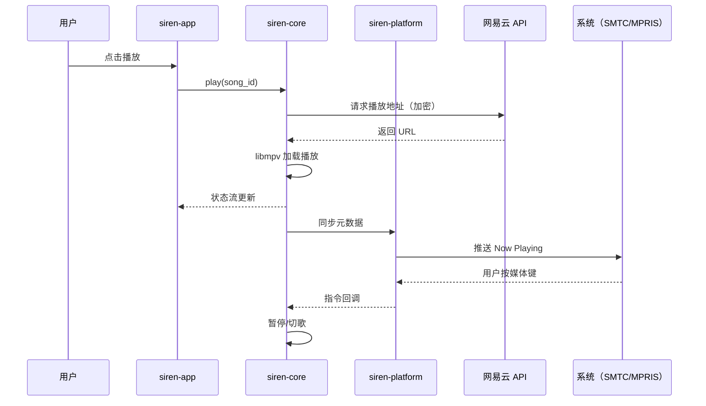
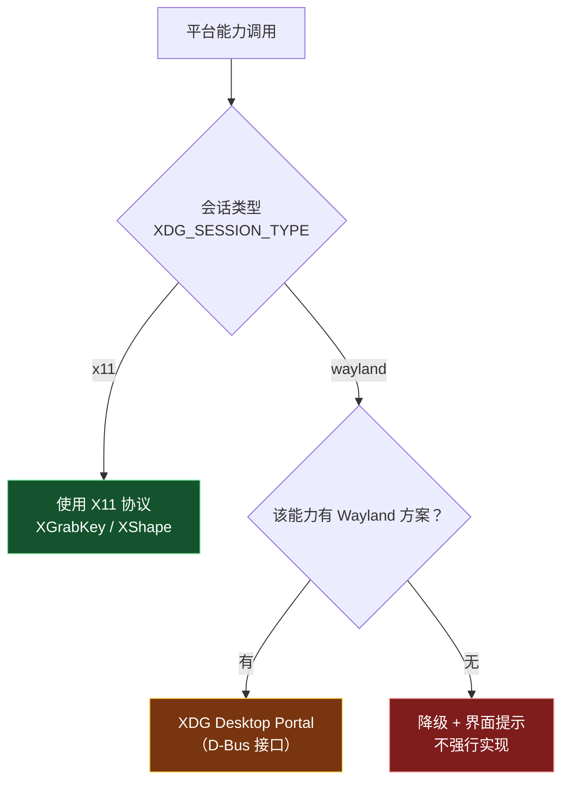

# 01 · 架构设计

> 本文定义 Siren 的模块划分、分层原则与数据流。
> 设计思路继承自 Melodia 桌面端探索（`@RequireAllPlatforms` 平台能力体系），并利用 Rust 的类型系统与条件编译进一步强化。

---

## 1. 设计目标

| 目标 | 说明 |
|---|---|
| **单代码库三平台** | 一套 Rust 代码同时构建 Windows / Linux / macOS |
| **平台差异编译期收敛** | 平台相关代码只存在于 `platform/` 层，且由 `#[cfg]` 在编译期决定 |
| **遗漏实现不可编译** | 借助 trait + 条件编译，缺失某平台实现时**编译失败**，而非运行期崩溃 |
| **核心逻辑可测试** | 网络、加密、数据模型等纯逻辑与平台无关，可在任意平台跑单元测试 |
| **原生优先** | 平台能力优先使用成熟 crate，而非自己造轮子 |

---

## 2. 分层结构



### 2.1 模块职责

| 模块 | 职责 | 平台相关 |
|---|---|---|
| `siren-app` | GPUI 界面、状态管理、用户交互 | ❌ |
| `siren-core` | 网络、加密、数据模型、播放抽象、歌词解析 | ❌ |
| `siren-platform` | 平台能力 trait 与各平台实现 | ✅ **唯一允许平台差异的模块** |

> **强制约束**：`siren-core` 与 `siren-app` 中**不得**出现 `#[cfg(target_os)]`。
> 平台判断必须收敛在 `siren-platform` 内部。

---

## 3. 平台能力层设计

### 3.1 组织方式

```
siren-platform/src/
├── lib.rs                 # trait 定义 + 统一导出
├── app_paths.rs           # trait AppPaths
├── media_session.rs       # trait MediaSession
├── tray.rs                # trait TrayIntegration
├── hotkey.rs              # trait GlobalHotkeyService
├── autostart.rs           # trait AutoStartManager
├── window.rs              # trait WindowDecoration
├── accent.rs              # trait SystemAccentProvider
├── lyric_window.rs        # trait DesktopLyricBehavior
├── ui_scale.rs            # trait UiScale
├── native_library.rs      # trait NativeLibraryLocator
├── windows/               # Windows 实现
├── linux/                 # Linux 实现（x11/ · wayland/ · mpris/ · sni/）
└── macos/                 # macOS 实现
```

### 3.2 条件编译模式

```rust
// siren-platform/src/lib.rs

/// 返回当前平台的媒体控制实现。
/// 各平台实现由 cfg 在编译期选择，未覆盖的平台直接编译错误。
#[cfg(target_os = "windows")]
pub use windows::media::WindowsMediaSession as PlatformMediaSession;
#[cfg(target_os = "linux")]
pub use linux::media::LinuxMediaSession as PlatformMediaSession;
#[cfg(target_os = "macos")]
pub use macos::media::MacMediaSession as PlatformMediaSession;

// 若新增目标平台而未提供实现，此处会因缺少定义而编译失败
```

**与 Melodia 的对比**：

| | Melodia（Kotlin） | Siren（Rust） |
|---|---|---|
| 校验机制 | KSP 注解处理器扫描 | `#[cfg]` 条件编译（语言内建） |
| 校验时机 | 编译期（需自建） | 编译期（免费） |
| 缺实现的后果 | KSP 报错中断编译 | 符号未定义，编译失败 |
| 额外成本 | 需维护 `:processor` 模块 | 无 |

> 这是选择 Rust 的核心收益之一：**Melodia 需要自建基础设施才能达到的编译期保证，在 Rust 里是语言特性。**

---

## 4. 数据流



### 4.1 状态管理

播放状态以**单向数据流**组织：

```
用户操作 → 指令 → PlaybackController → 状态变更 → 订阅者（UI / 平台层）
```

平台层通过订阅状态流来同步系统媒体卡片，通过回调将系统指令注入播放控制器——
这与 Melodia 的 `SystemMediaSession.bind(controller, viewModel)` 设计一致。

> 应用层的**状态归属、单一真源、事件/订阅、异步取消**等约定见
> [`10-状态管理约定.md`](10-状态管理约定.md)。

---

## 5. 平台差异的处理策略

### 5.0 平台优先级

| 平台 | 优先级 | 说明 |
|---|---|---|
| **Linux** | 🎯 **主要开发目标** | 相对 JVM 方案优势最大的平台 |
| **Wayland** | 🎯 **Linux 下的优先会话** | 新会话，且能力受限最多，优先摸清 |
| Windows | 次要 | 覆盖用户多，但平台能力较标准化 |
| macOS | 暂缓 | 见 [`06-路线图.md`](06-路线图.md) 阶段 4 |

**关于「Wayland 优先」的含义**：

1. 新功能**先在 Wayland 会话下验证**，再补 X11
2. 受 Wayland 协议限制的能力**明确降级**，不为其妥协架构
3. 托盘、媒体控制走 **D-Bus**（与显示协议无关），在两种会话下都正常

### 5.1 差异分类

| 类型 | 例子 | 处理方式 |
|---|---|---|
| **有成熟 crate** | 托盘、自启、全局热键、目录 | 直接用 crate，**不套 trait** |
| **靠构建配置分叉** | Linux 托盘去 GTK | feature 开关，**不写 `#[cfg]`** |
| **有统一 API 抽象** | 系统媒体控制（playwire） | 用统一 API，必要时回退自研 |
| **需平台分支** | 窗口装饰、桌面歌词穿透 | trait + `#[cfg]` + 平台子模块 |
| **协议差异（非 OS 差异）** | X11 vs Wayland | 在同一平台内按会话类型分支 |

### 5.2 优先用「构建配置」而非「代码分叉」

平台差异的处理有**两种手段**，应优先选前者：

| 手段 | 例子 | 优点 |
|---|---|---|
| **构建配置**（feature / `default-features`） | `tray-icon` 的 `ksni` feature 去 GTK | **代码保持统一**，无 `#[cfg]` |
| 代码分叉（`#[cfg]` + 平台模块） | 窗口装饰、歌词穿透 | 无法避免时才用 |

**判据**：如果一份代码能在所有平台通过，只是**底层依赖不同**，
那就该用 feature 开关，而不是写两套实现。

### 5.3 X11 / Wayland 的处理

**关键认知**：X11 与 Wayland 的差异**不是**可以用 GUI 工具包抹平的。Wayland 协议本身不提供
全局热键、窗口点击穿透、获取他人窗口句柄等能力——任何工具包（包括 GPUI 本身）都受同一限制。

因此策略是**按会话类型分支 + 明确降级**：



#### Wayland 下的能力对照

| 能力 | Wayland | 说明 |
|---|---|---|
| 系统媒体控制（MPRIS） | ✅ | D-Bus，与显示协议无关 |
| 托盘（SNI） | ✅ | D-Bus，与显示协议无关 |
| 全局快捷键 | ⚠️ | 仅 XDG Portal，非所有 DE 实现 |
| 桌面歌词点击穿透 | ❌ | 无对外协议，降级为置顶不穿透 |
| 窗口装饰 | — | 交给合成器 |

---

## 6. 与 Melodia 的架构对照

| 维度 | Melodia（Kotlin/Compose） | Siren（Rust/GPUI） |
|---|---|---|
| 平台抽象 | 10 个接口 + KSP 校验 | 10 个 trait + `#[cfg]` |
| 注册机制 | KSP 生成 Koin 模块 | 条件编译直接 `pub use` |
| DI | Koin | 依赖注入较简单，可直接构造或使用 `shaku` 等 |
| 状态管理 | StateFlow | `gpui` 的 Entity / 观察者模式 |
| UI | Compose | gpui-kit 组件 |
| 音频 | libmpv（JNA） | libmpv（原生绑定） |
| 平台能力 | 部分手写（SNI/JNA） | 优先 crate |
| 编译产物 | JVM + jpackage | 原生二进制 |

> 平台能力的 **trait 设计**可直接参考 Melodia 的接口定义，
> 详见 [`02-平台能力规格.md`](02-平台能力规格.md)。

---

## 7. 目录结构（规划）

```
Siren/
├── Cargo.toml                 # workspace
├── crates/
│   ├── siren-app/             # 应用层（UI）
│   ├── siren-core/            # 跨平台核心
│   └── siren-platform/        # 平台能力层
│       └── src/
│           ├── windows/
│           ├── linux/
│           └── macos/
├── docs/
├── LICENSE
└── README.md
```

---

## 8. 待定问题

| # | 问题 | 说明 |
|---|---|---|
| 1 | 状态管理方案 | GPUI 的 Entity 模型与 Melodia 的 StateFlow 差异较大，需设计订阅机制 |
| 2 | 网络层复用 | `siren-core` 的加密与请求签名需对照 Melodia 重写；是否 FFI 桥接 `:shared` 待评估 |
| 3 | 音频后端 | libmpv 绑定成熟度、边播边缓存（`stream-record`）在 Rust 侧的可行性 |
| 4 | 打包分发 | **Windows：cargo-packager → NSIS 安装包（已落地）**；Linux（deb/rpm/AppImage）、macOS（dmg + 公证）待做 |
