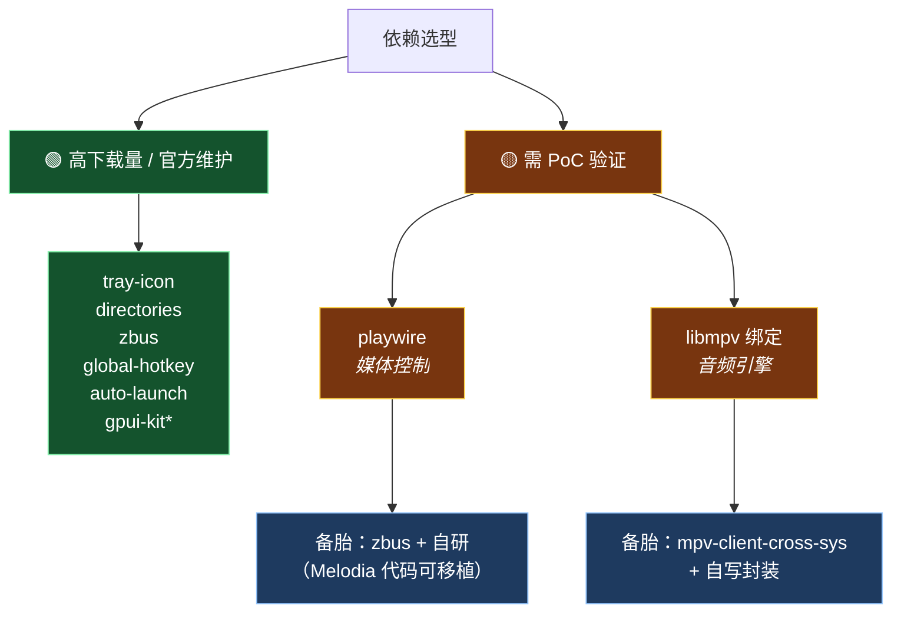

# 03 · 技术选型

> 本文记录各依赖的选型依据、备选方案与风险评估。数据取自 crates.io 实时查询。
> 标注 🟢 为可直接采用，🟡 为需验证，🔴 为高风险。

---

## 1. 总览

| 领域 | 选型 | 版本 | 下载量 | 评级 |
|---|---|---|---|---|
| UI 框架 | [`gpui-kit`](https://github.com/longbridge/gpui-kit) | 0.7 | — | 🟢 |
| 系统托盘 | [`tray-icon`](https://github.com/tauri-apps/tray-icon) | 0.26.1 | 34,255,405 | 🟢 |
| 目录规范 | [`directories`](https://github.com/soc/directories-rs) | 6.0.0 | 74,573,398 | 🟢 |
| D-Bus | [`zbus`](https://github.com/z-galaxy/zbus) | 5.19.0 | 93,915,806 | 🟢 |
| 全局快捷键 | [`global-hotkey`](https://github.com/tauri-apps/global-hotkey) | 0.8.0 | 6,178,929 | 🟢 |
| 开机自启 | [`auto-launch`](https://github.com/zzzgydi/auto-launch) | 0.6.0 | 6,653,729 | 🟢 |
| 系统媒体控制 | [`playwire`](https://github.com/SFG5453/playwire) | 2.0.0 | 3,050 | 🟡 |
| 音频引擎 | libmpv 绑定（待定） | — | — | 🟡 |

---

## 2. UI 框架：gpui-kit 🟢

### 选型理由

**GPUI Kit** 是 Longbridge 出品的 Rust 桌面应用框架，构建于 [GPUI](https://github.com/zed-industries/zed)
（Zed 编辑器的 UI 框架）之上。

| 指标 | 数值 |
|---|---|
| GitHub Stars | **16,900** |
| Commits | 2,555 |
| 组件数 | 75+ |
| 生产验证 | **Longbridge Pro**（已上线的商业桌面应用） |

### 关键能力匹配

| Siren 需求 | gpui-kit 能力 |
|---|---|
| 歌单/曲目长列表 | **Virtual Lists**（支持不等高条目） |
| 播放队列表格 | **Data Tables**（虚拟滚动、可调列宽、排序，支持数十万行） |
| 侧栏 + 主区布局 | **Dock Layout**（可拖拽、可嵌套、可序列化） |
| 歌词滚动动画 | **120 FPS** GPU 加速 |
| 主题/取色 | 语义化主题系统、多尺寸支持 |
| 图标 | 内置 Lucide 图标集 |

### 架构分层

```
gpui-kit             应用唯一依赖
├── gpui-base        无样式行为/状态/基础设施
└── gpui-component   完整样式化 UI 系统（75+ 组件）
```

设计哲学对标 **shadcn/ui**：「行为归基础层，表现归应用层」。
可选择用完整组件系统，也可在 `gpui-base` 上自建设计系统。

### 跨平台支持

GPUI 的 feature 中已包含 `wayland` 与 `x11`，`windows-manifest`，
明确支持 macOS / Windows / Linux。

### 备选方案对比

| 框架 | 模式 | 优势 | 劣势 |
|---|---|---|---|
| **gpui-kit** | GPUI（保留模式，组件化） | 组件丰富、商业验证、性能强 | 生态较新 |
| `egui` | 立即模式 | 生态最成熟、上手快 | **复杂布局与动画能力弱**，不适合精细 UI |
| `iced` | Elm 架构（保留模式） | 心智模型接近 Compose | 组件较少，需自建较多 |
| `Qt`（Rust 绑定） | 传统 retained | 成熟 | 绑定维护差，体积大 |

> **注意**：Melodia 桌面端有大量精细 UI（逐字歌词动画、Vibrant 取色、卡片布局、
> 悬浮滚动条）。**立即模式 GUI（egui）做这些会很痛苦**，可能比 Compose 更费劲。
> gpui-kit 的保留模式 + GPU 渲染更适合本项目。

---

## 3. 系统托盘：tray-icon 🟢

| 指标 | 数值 |
|---|---|
| 维护者 | **Tauri 团队** |
| 版本 | 0.26.1 |
| 下载量 | **34,255,405** |

### 平台封装

| 平台 | 底层实现 |
|---|---|
| Windows | `Shell_NotifyIcon` |
| Linux | StatusNotifierItem（SNI over D-Bus），回退 XEmbed |
| macOS | `NSStatusItem` |

### 价值

Melodia **手写了 400+ 行** Linux 托盘代码（`siren-platform` 无关的 SNI + DBusMenu 实现），
涵盖了：
- SNI 协议对象导出
- DBusMenu 菜单布局
- 图标 PNG 编码
- 宿主坐标换算

`tray-icon` **可直接替代**这些工作。这是选择 Rust 生态的主要收益之一。

---

## 4. 目录规范：directories 🟢

| 指标 | 数值 |
|---|---|
| 版本 | 6.0.0 |
| 下载量 | **74,573,398** |

### 说明

`directories` 是 `directories-jvm` 的 **Rust 原版**。

> **重要**：Melodia 曾评估 `directories-jvm` 后**决定不用**，原因是它会在 Windows 上
> 多插一层 `data/` 目录，破坏已有用户的升级路径（旧数据在 `%APPDATA%\Melodia\`，
> 换库后会去 `%APPDATA%\Melodia\data\` 读）。
>
> **Siren 是全新项目，无历史包袱**，可直接采用，无需担心此问题。

### 输出示例

```rust
let dirs = ProjectDirs::from("com", "cyanrhythm", "Siren").unwrap();

// Windows:  %APPDATA%\Siren
// Linux:    ~/.config/siren
// macOS:    ~/Library/Application Support/com.cyanrhythm.Siren
dirs.config_dir();

// Windows:  %LOCALAPPDATA%\Siren\cache
// Linux:    ~/.cache/siren
// macOS:    ~/Library/Caches/com.cyanrhythm.Siren
dirs.cache_dir();
```

---

## 5. 系统媒体控制：playwire 🟡

| 指标 | 数值 | 判断 |
|---|---|---|
| 版本 | 2.0.0（2026-10 发布） | 较新 |
| 下载量 | **3,050** | ⚠️ 偏少 |
| 维护者 | 个人 | ⚠️ 单人 |
| 描述 | MPRIS / SMTC / Now Playing 统一 API | ✅ 定位准确 |

### 风险

**3 千下载量意味着实际场景验证不足。** 而系统媒体控制恰恰是坑最多的部分：

Melodia 在真实 KDE 环境踩到的 8 个坑（详见
[`02-平台能力规格.md § 3.4`](02-平台能力规格.md#34-linux-mpris-实现要点血泪经验)）：

1. 必须先导出对象再抢总线名（否则 KDE 永久忽略该播放器）
2. 必须实现 `MediaPlayer2` 根接口
3. 必须提供 `CanPause` / `CanStop`（KDE 读不到会短路）
4. `mpris:trackid` 必须是对象路径类型
5. `xesam:artist` 是字符串数组
6. `mpris:length` 是微秒
7. 需主动推送 `PropertiesChanged`
8. `Set` 要接受 `LoopStatus` / `Shuffle`

**这些坑一个冷门库很可能都没覆盖。**

### 建议

**策略 A（推荐）：先用 playwire 做 PoC**

验证周期约 1 周，在 KDE 与 GNOME 上逐条测试上述 8 点。若通过则采用。

**策略 B（备胎）：`zbus` + 自研 MPRIS**

| 指标 | 数值 |
|---|---|
| zbus 版本 | 5.19.0 |
| zbus 下载量 | **93,915,806** |
| 成熟度 | 🟢 极高 |

- 工作量约 **300–400 行**
- Melodia 已有 Kotlin 实现（`LinuxSystemMediaSession.kt`，371 行）**可逐行对照移植**
- **因已知全部坑点，自研反而可能比赌冷门 crate 更稳**

### Windows / macOS

| 平台 | 方案 |
|---|---|
| Windows | SMTC（WinRT）—— playwire 若不可用，需 `windows` crate 绑定 |
| macOS | `MPNowPlayingInfoCenter` —— 通过 `objc2` 或 `objc2-media-player` 绑定 |

---

## 6. 音频引擎：libmpv 绑定 🟡

### 为什么选 libmpv

继承 Melodia 的选型结论（该结论经过实践验证）：

| 需求 | 为何排除其他方案 |
|---|---|
| 播放网易云加密音频流 | 需 HTTP 流式拉取 + 边下边播 |
| **边播边录制缓存** ⭐ | 依赖 mpv 原生 `stream-record` —— 决定性需求 |
| **双引擎交叉淡入** | 需两台引擎做音量 ramp |
| 多音频设备选择 | mpv 的 `audio-device-list` |
| 宽格式兼容 | 底层 FFmpeg |

**关键排除理由**：
- `Java Sound` 只支持 WAV/AIFF，无 HTTP 流、无 seek 缓冲
- `JavaFX Media` 格式支持少、无流录制
- VLC 方案过重（每实例拖整个运行时），双实例开销大

### Rust 侧的绑定选择

crates.io 上的候选（均为小规模项目）：

| crate | 下载量 | 说明 |
|---|---|---|
| `mpv` | 27,020 | safe bindings，相对最成熟 |
| `tauri-plugin-mpv` | 6,669 | Tauri 专用 |
| `mpv-client-dyn` | 1,575 | 动态加载 |
| `mpv-client-cross` | 332 | 跨平台客户端 API |
| `mpv-engine` | 380 | 工具包无关的嵌入核心 |

**风险**：这些绑定都**规模很小**，可能需要：
1. 试用 `mpv` crate，验证 `stream-record` 等高级选项是否暴露
2. 若不满足，用 `mpv-client-cross-sys` + 自己的安全封装（Melodia 的 `LibMpv.kt` 只映射了 11 个 API，移植成本低）

> **利好**：Melodia 的 libmpv 集成只用了 **11 个 C API**（`LibMpv.kt`），
> 且有完整的 `MpvEnginePair`（交叉淡入）、`AudioCache`（流录制）实现可对照。
> 这意味着**即使从零写绑定，工作量也可控**。

---

## 7. 其他依赖

### 全局快捷键：global-hotkey 🟢

| 指标 | 数值 |
|---|---|
| 维护者 | Tauri 团队 |
| 版本 | 0.8.0 |
| 下载量 | 6,178,929 |

**Wayland 限制**：依赖 XDG Desktop Portal，需用户授权，且非所有 DE 实现。
降级策略：依赖系统媒体键（MPRIS 已可接收）。

### 开机自启：auto-launch 🟢

| 指标 | 数值 |
|---|---|
| 版本 | 0.6.0 |
| 下载量 | 6,653,729 |

| 平台 | 机制 |
|---|---|
| Windows | 注册表 `HKCU\...\Run` |
| Linux | XDG autostart（`~/.config/autostart/*.desktop`） |
| macOS | Launch Agent |

### D-Bus：zbus 🟢

| 指标 | 数值 |
|---|---|
| 版本 | 5.19.0 |
| 下载量 | **93,915,806** |

用于：
- MPRIS 自研（若 playwire 不可用）
- StatusNotifierItem（若 tray-icon 不够用）
- XDG Desktop Portal（Wayland 全局快捷键）

---

## 8. 决策矩阵



> \* gpui-kit 虽无下载量数据（未在 crates.io 主索引统计），但有 16.9k stars 与商业项目验证，评级为 🟢。

---

## 9. 待决事项

| # | 事项 | 决策时机 |
|---|---|---|
| 1 | playwire 是否满足需求 | PoC 阶段（见 [`05-PoC验证清单.md`](05-PoC验证清单.md)） |
| 2 | libmpv 绑定选择 | PoC 阶段 |
| 3 | 是否复用 `:shared` 的网络层 | 核心开发前 |
| 4 | 打包方案（Linux/Windows/macOS） | 阶段 4 |
