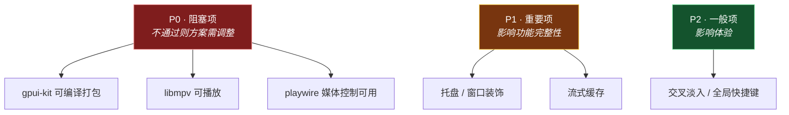
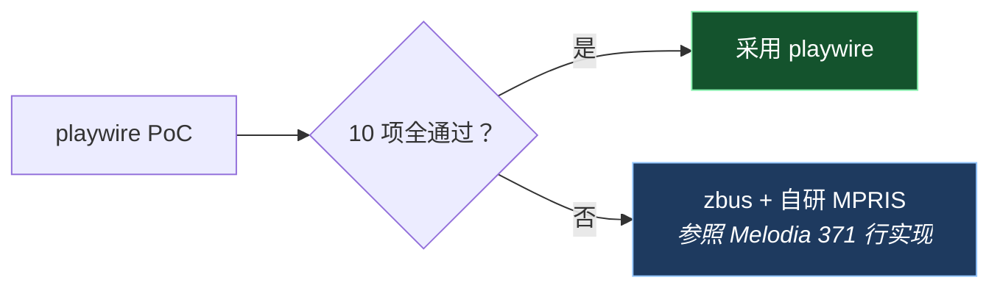

# 05 · PoC 验证清单

> 立项前必须验证的技术风险点。**建议先完成本文所有 P0 项，再投入核心开发**——
> 因为这些风险若在后期暴露，返工成本极高。

---

## 验证项总览



---

## P0-1 · gpui-kit 能否顺利构建与打包

**为什么要验**：这是整个方案的基石。若 gpui-kit 在目标平台无法编译或打包，方案不成立。

### 验证内容

| # | 项 | 验收标准 |
|---|---|---|
| 1 | Linux 编译 | `cargo build --release` 通过 |
| 2 | Windows 编译 | 同上（GitHub Actions 或本地） |
| 3 | 三平台 CI | 至少 Linux + Windows 能持续构建 |
| 4 | Linux 运行 | 在 X11 与 Wayland 会话下均能启动窗口 |
| 5 | 打包 | 能产出可执行的 Linux 包（deb/AppImage）与 Windows 安装包 |
| 6 | 体积 | 对比 JVM 方案（jpackage + runtime ≈ 100MB+）有明显优势 |

### 关键子项：UI 能力验证

需要确认 gpui-kit 能否实现 Melodia 的精细效果：

| Melodia 的 UI 效果 | gpui-kit 对应能力 | 验证方式 |
|---|---|---|
| 长列表滚动（歌单数百首） | Virtual Lists | 渲染 1000+ 项，检查滚动流畅度 |
| 表格视图（可调列宽、排序） | Data Tables | 用示例验证 |
| 侧栏 + 主区 + 面板布局 | Dock Layout | 用 `cargo run -p example-dock` |
| 封面取色（Vibrant） | 需自行实现算法 | 验证能否拿到图像像素数据 |
| 歌词逐字动画 | 自绘 + 动画 API | 验证逐帧渲染能力 |
| 悬浮滚动条、悬停效果 | hover 状态 + 自定义绘制 | 查看 story gallery |
| 窗口圆角 / 阴影 | GPUI 窗口能力 | 实测 |

**建议**：先跑 `cargo run`（story gallery）浏览全部组件，记录哪些能力缺失。

---

## P0-2 · libmpv 在 Rust 侧能否满足需求

**为什么要验**：`stream-record`（边播边缓存）是决定性需求，
且现有 Rust 绑定都是小项目，可能未暴露高级选项。

### 验证内容

| # | 项 | 验收标准 |
|---|---|---|
| 1 | 能加载 libmpv | 三平台各自加载成功 |
| 2 | HTTP 流式播放 | 播放网易云返回的音频 URL |
| 3 | **`stream-record` 可用** | 播放时能落盘成文件 |
| 4 | 精确 seek | `seek` 命令按绝对位置跳转 |
| 5 | 音频设备列举 | 读取 `audio-device-list` |
| 6 | 事件回调 | 能收到播放结束、属性变更事件 |
| 7 | 优雅降级 | libmpv 缺失时应用不崩溃 |

### 绑定选型验证

| 候选 | 验证要点 |
|---|---|
| `mpv` crate | 是否暴露 `stream-record`、`audio-device-list` |
| `mpv-client-cross` | 同上 |
| 自写绑定 | 用 `mpv-client-cross-sys` + 安全封装 |

> **利好**：Melodia 只用了 **11 个 C API** 就完成了全部播放功能
> （`LibMpv.kt`），因此即使自写绑定，工作量也可控。

### 交叉淡入验证（P2 可延后）

Melodia 用**双 mpv 实例**做音量 ramp（`MpvEnginePair`）。
需验证：
- 两个实例同时运行的开销
- 能否精确控制在 20ms 粒度调整音量

---

## P0-3 · playwire 能否满足媒体控制需求

**为什么要验**：playwire 下载量仅 3,050，而媒体控制的坑极多。

### 验证内容（对照 Melodia 的 8 个坑）

| # | 验证点 | 通过标准 |
|---|---|---|
| 1 | KDE 下媒体卡片能显示 | 播放后 KDE 媒体中心出现卡片 |
| 2 | 注册时序正确 | 先导出对象再抢总线名（或库已处理） |
| 3 | 根接口完整 | `Identity` / `DesktopEntry` 等被宿主识别 |
| 4 | **暂停按钮可用** | KDE 点击暂停有效（验证 `CanPause`） |
| 5 | trackid 类型正确 | 元数据被宿主完整读取 |
| 6 | artist 是数组 | 歌手正常显示 |
| 7 | 进度显示正常 | 验证 `mpris:length` 单位 |
| 8 | 卡片实时刷新 | 验证 `PropertiesChanged` 推送 |
| 9 | 循环/随机可写 | 宿主切模式能同步 |
| 10 | GNOME 下同样可用 | 验证是否只适配了 KDE |

### 环境矩阵

| 环境 | 必测 |
|---|---|
| KDE Plasma (Wayland) | ✅ 重点 |
| KDE Plasma (X11) | ✅ |
| GNOME (Wayland) | ✅ |
| Windows 10/11 | ✅（SMTC） |

### 若 playwire 不通过

切换到 **策略 B：`zbus` + 自研 MPRIS**：

- 工作量：约 300–400 行
- 依据：Melodia 的 `LinuxSystemMediaSession.kt`（371 行）可逐行对照
- 优势：**已知全部坑点**，可控性更高



---

## P1-1 · 托盘能力

**配置**：

```toml
tray-icon = { version = "0.26", default-features = false, features = ["ksni"] }
```

**验证内容**

| # | 项 | 验收标准 |
|---|---|---|
| 1 | **确认无 GTK 依赖** | `cargo tree` 中不含 `libappindicator` / `gtk` |
| 2 | `tray-icon` 三平台可用 | 图标正常显示 |
| 3 | **KDE Wayland 下点击有响应** | 左键激活、右键菜单（Melodia 在此踩过坑） |
| 4 | 图标透明 | 圆角外不填白（XEmbed 会填白） |
| 5 | 菜单项 | 菜单能正常弹出与响应（验证 DBusMenu 生效） |
| 6 | 主窗口隐藏/恢复 | 关闭时隐藏到托盘 |

**第 1 项最关键** —— 验证方式：

```bash
cargo tree -p siren-app | grep -iE "gtk|appindicator"
# 期望：无输出
```

> **背景**：`tray-icon` 默认 feature 是 `libappindicator`，会拖入 GTK3。
> 必须显式 `default-features = false, features = ["ksni"]` 才能走纯 D-Bus。
> 忘记加时**编译照样通过**，只是静默引入了 GTK 依赖——所以必须主动检查。

> **Wayland 注意**：Melodia 发现 XEmbed **收不到鼠标事件**。
> 走 `ksni` 从源头避开了 XEmbed 回退路径，但仍需实测确认。

---

## P1-2 · 流式缓存

**验证内容**

| # | 项 | 验收标准 |
|---|---|---|
| 1 | 播放时落盘 | 生成缓存文件 |
| 2 | 播完文件完整 | 无损坏 |
| 3 | 命中缓存不再联网 | 第二次播放走本地 |
| 4 | 缓存淘汰 | 按 LRU 或大小限制清理 |
| 5 | 中途 seek 的处理 | 明确策略（放弃该次录制 or 分段） |

> Melodia 的实现要点：录制中文件带 `.rec.` 标记，播完且 mpv 释放后才改名生效。

---

## P1-3 · 平台能力基础项

| # | 项 | 验收标准 |
|---|---|---|
| 1 | `directories` | 三平台路径符合规范 |
| 2 | `auto-launch` | Linux 写 XDG autostart；Windows 写注册表 |
| 3 | 窗口装饰 | 无边框窗口 + 自绘标题栏可行 |
| 4 | **KDE 分数缩放（125%/150%）** | 界面大小正常（Melodia 在此挣扎过） |

---

## P2 · 延后验证

| # | 项 | 说明 |
|---|---|---|
| 1 | 全局快捷键 | Wayland 需 Portal，非所有 DE 支持 |
| 2 | 桌面歌词点击穿透 | X11 可行，Wayland 降级 |
| 3 | 系统强调色 | 读 GTK/KDE 配置 |
| 4 | 单实例运行 | 文件锁或本地端口 |
| 5 | macOS 支持 | 若首期不做可延后 |

### P2-1 · `window-vibrancy` 兼容性

**为什么要验**：它是可选增强（窗口毛玻璃/亚克力），但可能与 GPUI 的窗口管理冲突。

| # | 项 | 验收标准 |
|---|---|---|
| 1 | **GPUI 能否获取原生窗口句柄** | 这是前提；拿不到句柄即无法接入 |
| 2 | Windows 下效果生效 | Acrylic / Mica 正常显示 |
| 3 | macOS 下效果生效 | 毛玻璃正常显示 |
| 4 | 与 GPUI 渲染是否冲突 | 无闪烁、无重绘异常 |
| 5 | Linux 降级 | 返回 `UnsupportedPlatform` 不崩溃 |

> **若不通过**：直接放弃该增强，不影响主体功能（Linux 本就不支持）。

---

## 验证环境建议

| 环境 | 用途 |
|---|---|
| Arch Linux (KDE Wayland) | Linux 主力验证（Melodia 的坑主要在此暴露） |
| Arch Linux (KDE X11) | 对比验证 |
| Ubuntu (GNOME Wayland) | 兼容性验证 |
| Windows 11 | Windows 验证 |
| GitHub Actions | 三平台持续构建 |

---

## 验证产出物

完成 PoC 后应产出：

- [ ] gpui-kit 最小可运行应用（含托盘、窗口）
- [ ] libmpv 播放验证（含 `stream-record`）
- [ ] 媒体控制验证报告（对照 10 项，含截图）
- [ ] 三平台构建产物
- [ ] 本文档的验证结果回填（每项标记 ✅ / ❌ / 备注）
- [ ] 若有关键项不通过，更新 [`03-技术选型.md`](03-技术选型.md) 的结论

---

## 风险排序

| 风险 | 影响 | 缓解 |
|---|---|---|
| 🔴 gpui-kit 无法打包 | 方案不成立 | 尽早验证；备选 iced |
| 🔴 libmpv 无 `stream-record` | 离线缓存功能缺失 | 自写绑定；或牺牲该功能 |
| 🟡 playwire 不满足 | 媒体控制需自研 | 用 zbus 自研（有参照实现） |
| 🟡 Wayland 下托盘无响应 | 托盘体验受损 | 验证 tray-icon；必要时降级 |
| 🟢 分数缩放问题 | 界面偏小 | GPUI 应已处理，实测确认 |
