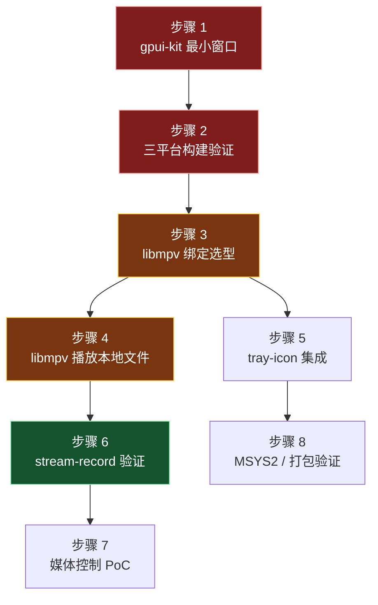

# 07 · 开发计划

> 本文是 [`06-路线图.md`](06-路线图.md) 的**战术层**补充。
>
> | 文档 | 定位 |
> |---|---|
> | `06-路线图.md` | **战略**：做什么、优先级、风险 |
> | `07-开发计划.md` | **战术**：怎么落地、什么顺序、每步产出什么 |

---

## 0. 前置说明

### 0.1 为什么需要本文

`06-路线图.md` 给出了五阶段划分，但**不足以直接开工**：

- 阶段 0 的验证项**没有执行顺序**，且未说明验证形式（独立项目 or 集成）
- 阶段 1 的"网络层"只是一行字，实际是**整个项目最大的隐藏工作量**
- 缺工作量量级，无法判断可行性

本文补齐这些。

### 0.2 工作量参照（基于 Melodia 实测）

Melodia 桌面端相关代码规模（`wc -l` 实测）：

| 模块 | Kotlin 行数 | 说明 |
|---|---|---|
| 加密（含测试） | 720 | WeApi / EApi / LinuxApi |
| 网络层（含测试） | 1,496 | 客户端、拦截器、设备 ID |
| 歌词（含测试） | 1,999 | LRC / QRC / TTML 解析 |
| 模型 | 184 | 基础 DTO |
| API 接口定义 | 3,098 | 各 feature 的 ApiService |
| **桌面端 UI** | **26,695** | Compose 界面 |

> **量级判断**：Siren ≈ Melodia 桌面端的 **70-80%** 工作量
> （UI 需重写、平台层需重做、网络层需移植，但设计已成型且有参照）。

---

## 1. 阶段 0 · PoC 验证（详细步骤）

### 1.1 验证形式决策

**关键问题**：PoC 是独立小项目，还是直接在 Siren 里做？

| 项 | 建议形式 | 理由 |
|---|---|---|
| gpui-kit 脚手架 | **直接建在 Siren** | 骨架已就绪，直接接入 `siren-app` |
| libmpv 播放 | **先在独立 crate 验证** | 隔离风险；绑定选型未定 |
| playwire / MPRIS | **独立小例程** | 不依赖 Siren 的其他部分 |
| tray-icon | **直接在 Siren** | 与窗口生命周期相关 |

**结论**：除 libmpv 绑定与 MPRIS 外，其余直接集成进 Siren。

### 1.2 执行顺序（含依赖）

### 1.3 各步骤明细

#### 步骤 1 · gpui-kit 最小窗口

| 项 | 内容 |
|---|---|
| **产出** | `siren-app` 能弹出一个空窗口 |
| **依赖** | 无 |
| **验收** | `cargo run -p siren-app` 在本地平台显示窗口 |
| **风险** | gpui-kit 依赖较重，首次编译可能耗时长 |

**做法**：
1. 在 `workspace Cargo.toml` 加入 `gpui-kit = "0.7"`
2. `siren-app` 的 `lib.rs` 实现 `run()`
3. 参考 `.opencode/skills/gpui-kit/references/recipes.md` 的完整范例

> ⚠️ 上游要求：**先读 `references/coding-guides.md`** 再动手。

#### 步骤 2 · 三平台构建验证

| 项 | 内容 |
|---|---|
| **产出** | CI 三平台均能构建出可运行产物 |
| **依赖** | 步骤 1 |
| **验收** | GitHub Actions ubuntu / windows / macos 全绿 |

**要点**：
- 本地只验证 Linux，Windows/macOS 靠 CI
- 需确认 GPUI 在 Linux 上的构建依赖（可能需 `libxkbcommon`、`libwayland-dev` 等）

#### 步骤 3 · libmpv 绑定选型

| 项 | 内容 |
|---|---|
| **产出** | 选定 crate 或决定自写 |
| **依赖** | 无（可并行） |
| **验收** | 能加载 libmpv 并调用 `mpv_create` |

**候选**：

| crate | 下载量 | 优先验证 |
|---|---|---|
| `mpv` | 27,020 | ⭐ 先试 |
| `mpv-client-cross` | 332 | 备选 |
| 自写（`mpv-client-cross-sys` + 封装） | — | 若前两者不满足 |

**关键验证点**：`stream-record` 等高级选项是否暴露。

> 参照：Melodia 只用了 **11 个 C API**（`LibMpv.kt`），自写成本可控。

> **结论（已定）**：`mpv` crate 于 2017 年停更（依赖 `log 0.3` / `num 0.1`），不采用；
> 改用**手写 `libloading` 运行时绑定**（对照 Melodia 的 11 个 C API），
> 满足「libmpv 缺失时优雅降级」，许可干净（MIT），且无 Windows 需导入库 `.lib` 的问题。
> 已真机验证出声。见 `crates/siren-core/src/player/mpv.rs`。

#### 步骤 4 · libmpv 播放本地文件

| 项 | 内容 |
|---|---|
| **产出** | 能播放一个本地音频文件 |
| **依赖** | 步骤 3 |
| **验收** | 出声 |

**注意**：先不碰网络，用本地文件排除变量。

#### 步骤 5 · tray-icon 集成

| 项 | 内容 |
|---|---|
| **产出** | 托盘图标显示，点击有响应 |
| **依赖** | 步骤 1 |
| **验收** | **KDE Wayland 下点击有效**（重点） |

> Melodia 在此踩过坑：XEmbed 在 Wayland 下收不到鼠标事件。

#### 步骤 6 · `stream-record` 验证

| 项 | 内容 |
|---|---|
| **产出** | 播放同时能落盘缓存文件 |
| **依赖** | 步骤 4 |
| **验收** | 文件完整、可再次播放 |

**这是决定性验证** —— 若 libmpv 的 `stream-record` 在 Rust 绑定中不可用，需重新评估方案。

#### 步骤 7 · 媒体控制 PoC

| 项 | 内容 |
|---|---|
| **产出** | KDE 媒体中心显示卡片，暂停按钮有效 |
| **依赖** | 步骤 4（需要能播放） |
| **验收** | 对照 [`05-PoC验证清单.md`](05-PoC验证清单.md) 的 10 项 |

**先试 playwire**，不满足则切 `zbus` 自研。

> ⚠️ 注意：playwire 的验证**需要真实播放中的音频**，因此排在步骤 4 之后。

#### 步骤 8 · 打包与 MSYS2 验证

| 项 | 内容 |
|---|---|
| **产出** | Linux 能打出可运行包；MSYS2 下能加载 libmpv |
| **依赖** | 步骤 5、6 |
| **验收** | 见下方清单 |

**验证项**：

- [ ] Linux：`cargo build --release` + 便携 tar 包
- [ ] Windows：libmpv DLL 随包，**双击 exe 能播放**（不依赖 PATH）
- [ ] MSYS2：从 UCRT64 shell 启动能找到 libmpv
- [ ] libmpv 缺失时**优雅降级**（不崩溃）

### 1.4 阶段 0 退出条件

全部满足才进入阶段 1：

- [ ] gpui-kit 三平台可构建可运行
- [ ] libmpv 能播放 + `stream-record` 可用
- [ ] 托盘在 KDE Wayland 下点击有效
- [ ] 媒体控制在 KDE 与 GNOME 下主流程可用
- [ ] 明确 libmpv 的分发方式（随包 / 依赖系统）

> **任一不满足** → 回到 [`03-技术选型.md`](03-技术选型.md) 重新评估，**不要硬着头皮往下做**。

---

## 2. 阶段 1 · 工作分解（重点：网络层）

### 2.1 关键路径

**关键路径说明**：`加密 → 登录 → 播放地址 → 播放`

**这是 MVP 的最短链**。其余功能（歌单、搜索、歌词）都不在此链上，可延后。

> 🔴 **加密是最大的不确定项** —— 它阻塞登录，登录阻塞一切需要鉴权的接口。

### 2.2 网络层拆解（被低估的部分）

Melodia 的网络相关代码 **1,496 行 + 加密 720 行**（含测试）。

| # | 子任务 | 规模 | 难点 | 优先级 |
|---|---|---|---|---|
| 1 | HTTP 客户端封装 | 小 | 选型 `reqwest` / `ureq` | P0 |
| 2 | **设备 ID 生成** | 小 | 算法需对照 | P0 |
| 3 | **WeApi 加密** | **中** | AES 两轮 + RSA，易写错 | P0 |
| 4 | **EApi 加密** | 中 | 另一套 AES 方案 | P0 |
| 5 | LinuxApi 加密 | 中 | 第三套方案 | P2 |
| 6 | 请求拦截器 | 小 | 按端点选加密方式 | P0 |
| 7 | Cookie / 登录态管理 | 中 | 持久化 + 失效检测 | P0 |
| 8 | 响应 DTO 定义 | **大** | 几十个结构体，体力活 | P0 |
| 9 | 错误码映射 | 中 | 业务错误 → 领域错误 | P1 |
| 10 | 空响应体处理 | 小 | 部分接口返回空 | P1 |

**说明**：
- 第 3、4 项是**真正的风险点** —— Melodia 源码里就记录了"RSA 模数拼写错误导致解密失败"的坑
- 第 8 项看似简单但**量最大**：Melodia 各 feature 的 ApiService 合计 **3,098 行**

### 2.3 加密的验收方式

**这是本阶段唯一有"标准答案"的部分**：

| 做法 | 说明 |
|---|---|
| 用 Melodia 的测试用例 | `NeteaseCryptoTest` + `XeapiCryptoTest` 已固化输入输出 |
| 逐项对照 | 相同明文 → 相同密文（注意随机密钥部分例外） |
| 不要凭记忆实现 | ⚠️ 加密参数极易记错 |

**推荐的实现顺序**：
1. 先做 **AES 部分**（可确定性验证）
2. 再做 **RSA 部分**
3. 最后组装 WeApi 流程
4. 用真实请求验证（登录接口）

### 2.4 阶段 1 的任务顺序

| 序号 | 任务 | 产出 | 阻塞关系 |
|---|---|---|---|
| 1.1 | HTTP 客户端 + 基础请求 | 能发出明文请求 | — |
| 1.2 | 加密实现 + 测试 | 加密通过对照验证 | — |
| 1.3 | 拦截器 + 设备 ID | 请求自动加密 | 1.1, 1.2 |
| 1.4 | 扫码登录 | 拿到登录态 | 1.3 |
| 1.5 | 歌曲详情 API | 能查到歌曲信息 | 1.4 |
| 1.6 | 播放地址 API | 能拿到音频 URL | 1.4 |
| 1.7 | libmpv 封装 | 可播放网络流 | 阶段 0 |
| 1.8 | 播放队列 | 顺序/随机/循环 | 1.7 |
| 1.9 | 播放条 UI | 可控制播放 | 1.8 |
| 1.10 | 状态管理 | 播放状态流 | 1.9 |

**MVP 完成标志**：`1.1 → 1.9` 全通，即**能登录、搜到歌、播放并控制**。

---

## 3. 工作量量级评估

### 3.1 分模块

| 模块 | 参照行数 | Siren 预计 | 工作量量级 |
|---|---|---|---|
| 网络 + 加密 | 2,216（含测试） | 1,500-2,000 | 🔴 大 |
| 歌词解析 | 1,999 | 1,500 | 🟡 中（纯逻辑，好移植） |
| 平台能力 | 2,574（Melodia 实测） | 1,500-2,500 | 🟡 中（部分用 crate 替代） |
| 音频引擎 | ~1,000 | 800-1,200 | 🟡 中（有参照） |
| **UI** | **26,695** | 15,000-25,000 | 🔴 **最大** |
| 状态管理 | — | 1,000+ | 🟡 中（GPUI 模型不同） |
| 骨架 + 文档 | — | 已完成 | — |

### 3.2 关键判断

| 结论 | 说明 |
|---|---|
| **UI 是最大工作量** | 占总量的一半以上，且需重写 |
| **网络层是最大风险** | 量不算最大，但**调试成本高** |
| **平台层反而省力** | 因 `tray-icon` 等 crate 替代了 Melodia 手写的部分 |
| **歌词/加密有"标准答案"** | 可对照移植，比 UI 确定的得多 |

### 3.3 相对 Melodia 的工作量

| 项 | 比例 | 说明 |
|---|---|---|
| 可直接移植（逻辑） | ~25% | 加密、歌词、算法 |
| 需重写（UI） | ~50% | Compose → GPUI |
| 需重做（平台） | ~15% | 但有 crate 助力 |
| 全新（GPUI 生态） | ~10% | 状态管理、组件自绘 |

> **总计**：Siren ≈ Melodia 桌面端 **70-80%** 的工作量。

---

## 4. 里程碑验收标准（可量化）

修正 `06-路线图.md` 中模糊的表述。

### 阶段 1 → 2

- [ ] 能通过扫码登录，登录态可持久化（重启后仍登录）
- [ ] 能搜索歌曲并展示结果列表
- [ ] 能获取播放地址并**成功播放**（出声）
- [ ] 播放条能控制：播放/暂停、上下一首、进度拖动
- [ ] 播放模式（顺序/随机/循环）切换正确
- [ ] 加密实现通过 Melodia 测试用例的等价校验

### 阶段 2 → 3

- [ ] 系统媒体键（Play/Pause/Next/Prev）**在 KDE 与 GNOME 下均生效**
- [ ] 系统媒体卡片显示正确的标题/歌手/封面
- [ ] 关闭窗口最小化到托盘，托盘菜单可恢复窗口
- [ ] 播放过的歌曲在**断网后仍能播放**（缓存生效）
- [ ] 重复启动时唤起已有窗口，不产生第二个实例

### 阶段 3 → 4

- [ ] 歌单列表 / 详情 / 播放正常
- [ ] 歌词滚动与播放进度同步（误差 < 200ms）
- [ ] 主题切换与封面取色生效
- [ ] 图片 / 元数据 / 歌词磁盘缓存命中（断网可见、容量可清）
- [ ] 连续使用 2 小时无崩溃、无明显内存增长

---

## 5. 补充风险（`06-路线图.md` 未列）

| # | 风险 | 影响 | 应对 |
|---|---|---|---|
| 1 | **加密调试成本高** | 阻塞整条关键路径 | 用 Melodia 测试用例逐项校验；预留充足时间 |
| 2 | **GPUI 生态不成熟** | 缺第三方组件，需自绘 | 提前读 gpui-kit 的 design-guides；接受 UI 简化 |
| 3 | **GPUI 状态模型差异大** | StateFlow 心智不适用 | 优先读 `coding-guides.md` 的 Entity 章节 |
| 4 | **libmpv 分发复杂** | 打包体验差 | 阶段 0 就验证；优先自带精简构建 |
| 5 | **Windows 开发环境** | 本地难验证 | 依赖 CI；或用 MSYS2（注意 UCRT64） |

---

## 6. 当前状态与下一步

> 更新为**实际进度**（Windows 开发机；Linux/Wayland 待验）。

**阶段 0 · 基本完成**：步骤 1（gpui-kit 窗口）、3（**选定手写 FFI**）、4（播放）、
7（playwire 媒体控制）已完成；步骤 2/8 见 CI；步骤 5（托盘）、6（`stream-record`）待做。

**阶段 1 · 进行中**：`1.1–1.3`（HTTP / 加密 / 拦截器）✅ · `1.4`（Cookie 登录 ✅、**扫码登录 ✅**）·
搜索 / 歌单 / 首页 UI ✅ · 真实封面 ✅ · 歌单写操作（收藏/加歌/改名/改封面/删除/新建/排序·置顶）✅ ·
大歌单曲目分页 ✅ · `1.7–1.10`（libmpv 封装 / 队列 / 播放条 / 状态流）✅ ·
音乐库分栏 + 歌手详情 + 个人主页 + 歌曲右键菜单 ✅ · 播放会话恢复 ✅ ·
工程基建（日志库、设置/账号单一真源、Root 拆分、页面异步取消、全局 Toast）✅。
阶段 2 平台集成（托盘/MPRIS/热键/单实例）待做。

**下一步**（按新优先级）：

1. **CI 三平台**：已在 `.github/workflows/ci.yml` 补 Linux 系统依赖，待跑通
2. **Linux/Wayland 实机**：托盘（`tray-icon` + `ksni`）、MPRIS 10 项、分数缩放
3. **阶段 2 平台集成**：托盘、单实例、全局快捷键 / 开机自启
4. 阶段 1 收尾：账号设置（等级/VIP/绑定/改资料/签到/改头像）
